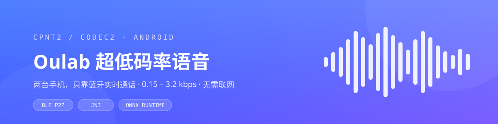
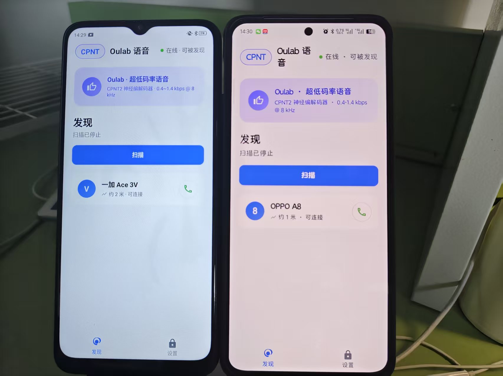
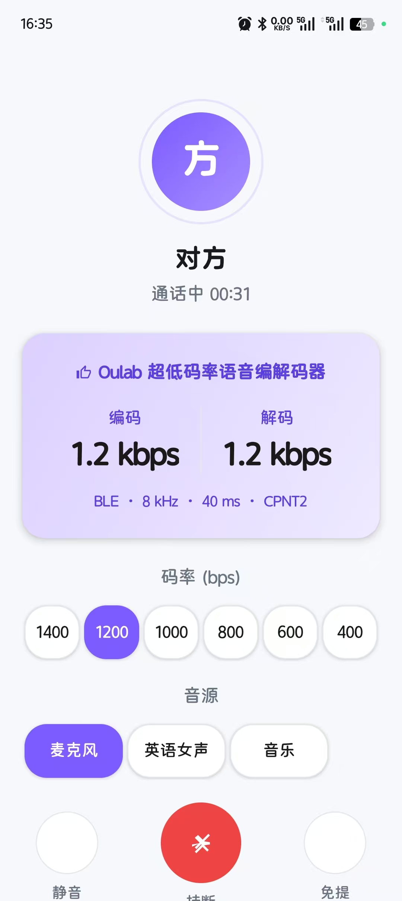
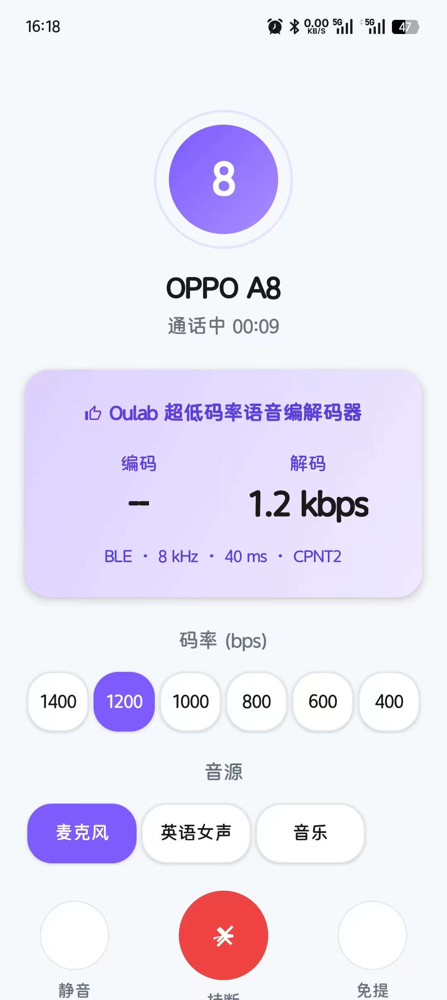
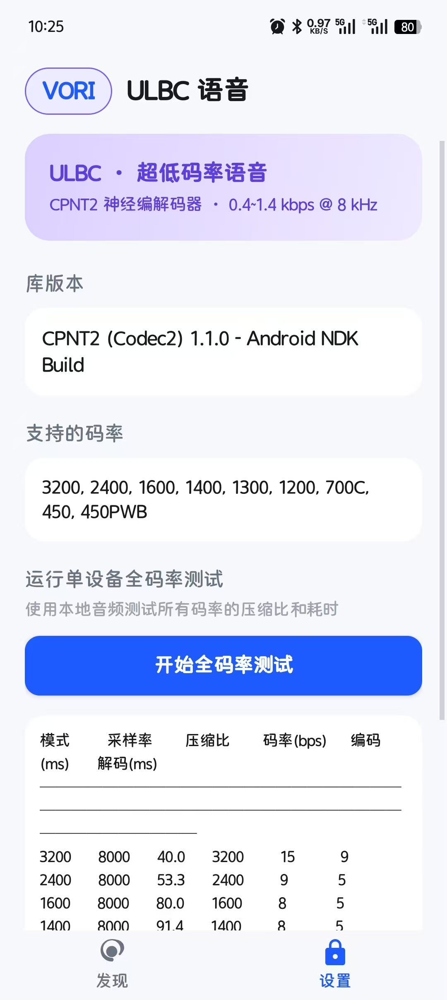
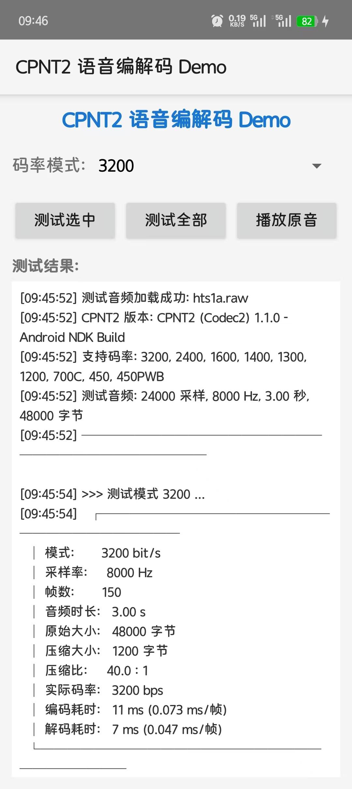

<div align="center">



# Oulab 语音 · CPNT2 超低码率语音编解码 Demo

**把语音压到 0.15 kbps，用蓝牙在两台手机之间实时通话 —— 不联网、不走服务器、不依赖任何云端。**

<p>
  
  
  
  
  
</p>

[项目简介](#-项目简介) · [效果展示](#-效果展示) · [工作原理](#-工作原理) · [快速开始](#-快速开始) · [BLE 协议](#-ble-协议) · [常见问题](#-常见问题)

</div>

---

## 📖 项目简介

这是一个跑在 Android 上的**超低码率语音编解码 Demo**。编解码内核 **CPNT2** 由开源项目 [Codec2](https://github.com/drowe67/codec2) 改造而来，App 负责采集与播放、JNI 桥接、BLE 点对点传输，以及一套接近系统电话的交互界面。

它想回答一个问题：**在没有基站、没有 WiFi、没有服务器的情况下，两台手机能不能通话？**

答案是能。把 8 kHz 语音切成 40 ms 一帧，压到 3~8 个字节，塞进 BLE 的一个 GATT 包里发出去，对端解出来直接播——1.2 kbps 的码率下，人声依然清晰可懂。

| 场景 | 说明 |
| --- | --- |
| 🛰 **无网通信** | 蓝牙直连，无需 SIM 卡、路由器或中继服务 |
| 🎧 **算法验证** | 一套 App 同时验证传统 DSP（Codec2）与神经编解码（ClariCodec）两条链路 |
| 🔬 **主观评测** | 通话中实时切码率、切音源，用耳朵直接对比音质与压缩比 |
| 📱 **可穿戴 / 嵌入式预研** | 极低码率 + 极简传输，适合作为 BLE 语音链路的参考实现 |

> 本项目是个人学习与工程验证用的 Demo，UI 参考 Oulab 的设计语言，与 Oulab 官方无关。

## ✨ 功能特性

- **双机 BLE 通话** —— 一台编码发送、一台解码播放；主动连接方为接收端，被连接方为发送端，角色在会话建立时自动协商。
- **9 档传统码率 + 2 档神经码率** —— 3200 / 2400 / 1600 / 1400 / 1300 / 1200 / 700C / 450 / 450PWB bps，以及 NEURAL 300 / 150 bps。
- **通话中实时切档** —— 点一下码率 chip，下一帧立即生效，同时通过控制帧通知对端，不需要挂断重连。
- **三种音源** —— 麦克风 / 内置英语女声 / 内置音乐，互相切换即可对比不同信号下的编码表现；静音对所有音源生效。
- **单机回环测试** —— 没有第二台手机也能跑通整条链路：音源 → 编码 → 本地解码 → 扬声器。
- **全码率自测** —— 内置 3 秒测试音频，一键跑完全部模式，输出压缩比、编码 / 解码耗时。
- **完整通话 UI** —— 编码 / 解码实时码率、通话计时、静音、免提 / 听筒、挂断。
- **可观测性** —— 全局崩溃捕获 + logcat 收集，出问题能直接把日志捞出来。

## 📸 效果展示

<div align="center">
  
  <br />
  <sub>左：一加 Ace 3V 扫描到 OPPO A8；右：OPPO A8 正在广播，等待连接</sub>
</div>

<br />

| 发送端（编码 + 解码） | 接收端（纯解码） | 设置 & 全码率自测 |
| :---: | :---: | :---: |
|  |  |  |
| 编码 1.2 kbps 实时发送，同时解码对端回传 | 本机只做解码，编码一栏显示 `—` | 库版本、支持的码率、一键自测入口 |

> 截图拍摄于 v1.1.0 之前的构建：当时码率 chip 展示的是 1400–400 的等距档位，其中部分档位复用相邻模式；当前版本已改为上表中的 9 档真实模式。

## 🧠 工作原理

整条链路只有四步：**采集 → 分帧编码 → BLE 传输 → 解码播放**。

```
 发送端 Encoder                                    接收端 Decoder
┌────────────────────────┐                      ┌────────────────────────┐
│  麦克风 / 测试音源       │                      │  扬声器 / 听筒          │
│        ↓ PCM 16 bit     │                      │        ↑ PCM 16 bit     │
│  分帧 40 ms（320/640）   │                      │  组帧 40 ms             │
│  CPNT2 / ClariCodec     │                      │  CPNT2 / ClariCodec     │
│  编码 → 3~8 Byte / 帧    │                      │  解码 ← 3~8 Byte / 帧    │
└───────────┬────────────┘                      └───────────▲────────────┘
            │                                                │
            │      BLE GATT · 单包 ≤ 20 B · 40 ms / 帧        │
            └────────►  GATT Server  ⇄  GATT Client  ────────┘
```

| 分层 | 关键类 | 职责 |
| --- | --- | --- |
| UI | `DiscoverActivity` / `CallActivity` / `SettingsActivity` | 设备发现、通话控制、自测与日志 |
| 会话 | `EncoderPipeline` / `DecoderPipeline` | 帧循环、码率切换、静音、状态上报 |
| 编解码 | `Cpnt2Codec` / `NeuralCodec` / `CodecSpec` | 统一 `AudioCodec` 接口，屏蔽 DSP 与神经两条内核的差异 |
| 传输 | `BleGattServer` / `BleGattClient` / `BleProtocol` | 广播、扫描、GATT 读写与通知、包格式编解码 |
| 原生 | `cpnt2_jni.c` + `libcpnt2.so` | CPNT2 的 C 实现，通过 JNI 暴露给 Java |

**两套内核，一套接口。** `CodecSpec` 用一张表把「模式名 ↔ 线上 codecId ↔ 采样率 ↔ 帧长 ↔ 显示标签」集中管理，上层完全不关心当前跑的是 Codec2 还是 ONNX 模型：

- **CPNT2**：传统 DSP 编解码，8 kHz（450PWB 为 16 kHz），40 ms 帧，纯 C 实现，`.so` 只有 600 KB 左右。
- **ClariCodec**：神经编解码，16 kHz / 80 ms 帧，编码器与解码器是**两个独立的 ONNX 图**，各自携带递推 state，由 ONNX Runtime 的 Java 绑定驱动。

> 神经链路对时序很敏感：两端必须**逐帧发送、不得跳帧**，否则 state 失步会直接变成噪声。相关约束写在 `NeuralCodec` 的类注释里。

## 🎚 码率与模式

| 模式 | 采样率 | 帧长 | 压缩比<sup>①</sup> | 说明 |
| --- | :---: | :---: | :---: | --- |
| `3200` | 8 kHz | 40 ms | 40 : 1 | 音质最好，适合安静环境 |
| `2400` | 8 kHz | 40 ms | 53 : 1 | 音质与带宽的平衡点 |
| `1600` | 8 kHz | 40 ms | 80 : 1 | 经典 FreeDV 1600 档 |
| `1400` | 8 kHz | 40 ms | 91 : 1 | |
| `1300` | 8 kHz | 40 ms | 98 : 1 | 默认档，日常演示首选 |
| `1200` | 8 kHz | 40 ms | 107 : 1 | 截图中的通话档位 |
| `700C` | 8 kHz | 40 ms | 183 : 1 | 强压缩，可懂度仍可接受 |
| `450` | 8 kHz | 40 ms | 284 : 1 | 极限压缩 |
| `450PWB` | 16 kHz | 40 ms | 569 : 1 | 宽带模式，高频更自然 |
| `NEURAL300` | 16 kHz | 80 ms | 853 : 1 | 神经编解码，2 × 12 bit / 帧 |
| `NEURAL150` | 16 kHz | 80 ms | 1707 : 1 | 神经编解码，1 × 12 bit / 帧 |

<sup>①</sup> 以 16 bit PCM 原始码率为基准（8 kHz → 128 kbps，16 kHz → 256 kbps）。神经模式的模型文件约 **562 MB（编码）/ 637 MB（解码）**，体积过大不随仓库分发；未安装模型时，通话页会自动隐藏神经档位。

## 🚀 快速开始

### 环境要求

| 依赖 | 版本 | 备注 |
| --- | --- | --- |
| JDK | 17 | Gradle 8.0 不支持 JDK 21，会报 `Unsupported class file major version` |
| Android SDK | Platform 34 + Build-Tools 34 | `compileSdk 34` / `targetSdk 34` |
| Android Studio | 或纯命令行 | 直接用 `./gradlew` 也可以 |
| 手机 | Android 8.0+（API 26） | **必须支持 BLE 外设（广播）模式**，个别机型被厂商裁剪 |
| NDK | r27c（可选） | 仅在需要重新编译 `.so` 时使用 |

### 编译与安装

```bash
git clone https://github.com/star211199/cpnt2-voice-android.git
cd cpnt2-voice-android

# 编译 Debug 包
./gradlew :app:assembleDebug

# 安装到已连接的手机
adb install -r app/build/outputs/apk/debug/app-debug.apk
```

Windows 命令行把 `./gradlew` 换成 `gradlew.bat` 即可。首次编译会下载 AndroidX、Flexbox、ONNX Runtime 等依赖，耐心等一会儿。

### 推送神经模型（可选）

只玩 CPNT2 的 9 档码率可以跳过这一步。

```bash
adb shell am start -n com.cpnt2.demo/.DiscoverActivity   # 先跑一次，让 App 建好私有目录
adb shell am force-stop com.cpnt2.demo

adb shell run-as com.cpnt2.demo mkdir -p files/models
adb push claricodec_300bps_enc.onnx /data/local/tmp/
adb push claricodec_300bps_dec.onnx /data/local/tmp/
adb shell run-as com.cpnt2.demo cp /data/local/tmp/claricodec_300bps_enc.onnx files/models/
adb shell run-as com.cpnt2.demo cp /data/local/tmp/claricodec_300bps_dec.onnx files/models/

adb shell run-as com.cpnt2.demo ls -la files/models/       # 核对
```

模型放在 App 私有目录，不需要 root；一个码率约 1.2 GB，空间紧张就只推 300 bps。

### 两台手机通话

1. 两台手机安装同一个 APK，打开后授予**蓝牙 / 位置 / 麦克风**权限（Android 12+ 只弹蓝牙权限，12 以下扫描还需要定位权限）。
2. 两台都停在「发现」页——此时本机已在广播，同时也具备扫描能力。
3. 在 **A 手机**点「扫描」，列表里出现 B 的机型名后，点右侧的电话图标。
4. B 自动进入通话页并开始编码发送；A 作为接收端解码播放。

> 想反向传输，反过来从 B 发起连接即可。角色由「谁主动连」决定，不需要手动配置。

### 单机回环测试

发现页点「单机测试 · 无需蓝牙」→ 本机音源直接进编码器，编出来的码流立刻喂给解码器，再从扬声器放出来。用来验证编解码链路、试听各档音质，不需要第二台设备。

### 通话页控件

| 控件 | 行为 |
| --- | --- |
| 码率 chips | 9 档 CPNT2 + 已就绪的神经档位，点击即时切换并通知对端 |
| 音源 chips | 麦克风 / 英语女声 / 音乐，切换立即生效 |
| 静音 | 对所有音源生效（麦克风停止采集 / 测试音源暂停生成） |
| 挂断 | 断开 GATT 连接并退出通话页 |
| 免提 | 扬声器 ↔ 听筒切换（媒体音量 / 通话音量分别处理） |

## 📡 BLE 协议

### Service 与 Characteristic

| 名称 | UUID | 方向 |
| --- | --- | --- |
| Service | `c3a10001-d4e5-f6a7-b8c9-0123456789ab` | 公共 |
| RX（Write） | `c3a10002-d4e5-f6a7-b8c9-0123456789ab` | Central → Peripheral |
| TX（Notify） | `c3a10003-d4e5-f6a7-b8c9-0123456789ab` | Peripheral → Central |
| INFO（Read） | `c3a10004-d4e5-f6a7-b8c9-0123456789ab` | 设备信息 |

> 这里刻意使用**随机 128-bit UUID**，而不是 `0000xxxx-0000-1000-8000-00805f9b34fb` 这类基础 UUID。后者会被 Android 当作 16-bit UUID 处理，在部分国产 ROM（如 ColorOS）上会导致 service 发现失败。

### 数据包格式

单包 ≤ 20 字节（ATT MTU 23），CPNT2 各模式的压缩帧最大 8 字节，一帧一包，无需分包。

```
[0]      包类型  0x01 音频 / 0x02 控制 / 0x03 文本 / 0x04 PING / 0x05 PONG
[1]      子类型  音频帧 → codecId；控制帧 → 控制子类型
[2..19]  负载    音频帧为编码后的字节
```

**控制子类型**

| 值 | 含义 |
| --- | --- |
| `0x01` | HELLO，会话建立 |
| `0x02` | ROLE_REQUEST，声明角色 |
| `0x03` | ROLE_ACCEPT，角色确认 |
| `0x04` | BITRATE_CHANGE，通知对端切档 |
| `0x05` | HANGUP，挂断 |

**codecId 映射**

| ID | 1 | 2 | 3 | 4 | 5 | 6 | 7 | 8 | 9 | 100 | 101 |
| --- | --- | --- | --- | --- | --- | --- | --- | --- | --- | --- | --- |
| 模式 | 3200 | 2400 | 1600 | 1400 | 1300 | 1200 | 700C | 450 | 450PWB | NEURAL300 | NEURAL150 |

## 📊 性能

**原生库体积**（Release，NDK r27c 编译）

| ABI | `libcpnt2.so` | `libcpnt2_jni.so` | 适用设备 |
| --- | ---: | ---: | --- |
| `arm64-v8a` | 617 KB | 50 KB | 现代 64 位手机（推荐） |
| `armeabi-v7a` | 487 KB | 40 KB | 老款 32 位手机 |
| `x86_64` | 646 KB | 48 KB | 模拟器 |

**单设备全码率自测**（OPPO A8，3 秒测试音频 / 150 帧）

| 模式 | 压缩比 | 编码总耗时 | 解码总耗时 | 单帧编码 |
| --- | ---: | ---: | ---: | ---: |
| 3200 | 40.0 : 1 | 15 ms | 9 ms | 0.10 ms |
| 2400 | 53.3 : 1 | 9 ms | 5 ms | 0.06 ms |
| 1600 | 80.0 : 1 | 8 ms | 5 ms | 0.05 ms |
| 1400 | 91.4 : 1 | 8 ms | 5 ms | 0.05 ms |

每帧只占 40 ms 的时间预算，编码耗时不到 0.1 ms，CPU 占用可以忽略；真正的瓶颈在 BLE 的调度抖动，而不是算力。

<details>
<summary>展开看一次完整的自测日志（3200 模式）</summary>

<br />



</details>

> Debug APK 约 56 MB，主要是 ONNX Runtime 三个 ABI 的 `.so`。只保留 `arm64-v8a` 可以显著瘦身，见 `app/build.gradle` 的 `abiFilters`。

## 📁 项目结构

```
.
├── app/
│   ├── build.gradle
│   └── src/main/
│       ├── AndroidManifest.xml
│       ├── assets/
│       │   └── hts1a.raw                  # 13.8 s 测试音频（8 kHz / 16 bit / mono）
│       ├── jni/
│       │   ├── cpnt2_jni.c                # JNI 包装层（Codec2Native）
│       │   └── CMakeLists.txt             # 从源码编译 .so 时使用
│       ├── jniLibs/{arm64-v8a,armeabi-v7a,x86_64}/
│       │   ├── libcpnt2.so                # CPNT2 编解码内核
│       │   └── libcpnt2_jni.so            # JNI 桥接
│       ├── java/com/cpnt2/demo/
│       │   ├── Codec2Native.java          # JNI 接口声明
│       │   ├── DiscoverActivity.java      # 发现页：扫描 + 广播 + 单机入口
│       │   ├── CallActivity.java          # 通话页：码率 / 音源 / 静音 / 免提 / 挂断
│       │   ├── SettingsActivity.java      # 设置页：版本、码率、全码率自测、日志
│       │   ├── audio/
│       │   │   ├── AudioCodec.java        # 编解码统一接口
│       │   │   ├── Cpnt2Codec.java        # CPNT2 适配
│       │   │   ├── NeuralCodec.java       # ClariCodec 适配（ONNX）
│       │   │   ├── OrtNeuralEngine.java   # ONNX Runtime 会话封装
│       │   │   ├── NeuralEngineProvider.java
│       │   │   ├── CodecSpec.java         # 模式 ↔ codecId ↔ 采样率 ↔ 标签
│       │   │   ├── EncoderPipeline.java   # 采集 → 编码 → 发送
│       │   │   ├── DecoderPipeline.java   # 接收 → 解码 → 播放
│       │   │   ├── AudioRecorder.java     # 麦克风采集
│       │   │   ├── AudioPlayer.java       # 扬声器 / 听筒播放
│       │   │   ├── TestSource.java        # 合成音源（女声 / 音乐）
│       │   │   └── BleCodecMode.java      # 模式名 ↔ ID（Java 侧）
│       │   ├── ble/
│       │   │   ├── BleProtocol.java       # UUID / 包格式 / 控制码
│       │   │   ├── BleAdvertiser.java     # 广播端
│       │   │   ├── BleScanner.java        # 扫描端
│       │   │   ├── BleGattServer.java     # GATT Server
│       │   │   ├── BleGattClient.java     # GATT Client
│       │   │   └── BleGattServerHolder.java
│       │   └── util/
│       │       ├── PermissionManager.java # 运行时权限
│       │       ├── CrashHandler.java      # 全局崩溃捕获
│       │       └── LogCollector.java      # logcat 收集
│       └── res/                           # 布局、主题、图标
├── images/                                # README 截图与 banner
├── build.gradle
├── settings.gradle
└── gradle.properties
```

## 🔧 重新编译原生库

修改 `app/src/main/jni/cpnt2_jni.c` 或 Codec2 的 C 源码后，需要重新产出 `.so`：

```bash
cmake -G "MinGW Makefiles" \
  -DCMAKE_TOOLCHAIN_FILE="$ANDROID_NDK/build/cmake/android.toolchain.cmake" \
  -DANDROID_ABI=arm64-v8a \
  -DANDROID_PLATFORM=android-21 \
  -DCMAKE_BUILD_TYPE=Release .

mingw32-make -j4
```

产物拷贝到 `app/src/main/jniLibs/<abi>/`，然后重新 `assembleDebug`。三个 ABI 各跑一遍即可。

## ❓ 常见问题

<details>
<summary><b>扫描不到对方 / 列表一直是空的？</b></summary>

- 确认两台手机的蓝牙都已打开，且 App 在前台。
- Android 12 以下扫描需要**定位权限**，并且系统定位开关要打开。
- 两台手机都要打开 App：广播是在 App 启动后才开始的，退到后台可能被系统掐掉。
- 部分 ROM 限制后台广播，建议在系统设置里给 App 关闭电池优化。
- 距离保持在 10 米内，中间别隔着金属桌板。

</details>

<details>
<summary><b>连上了但没声音？</b></summary>

- 发送端是否选中了「麦克风」或「英语女声」？静音状态会同时停掉所有音源。
- 接收端是否处于扬声器模式？点一下「免提」切换试试。
- 检查媒体音量（免提走媒体通道，听筒走通话通道，是两套音量）。
- 若发送端用麦克风，确认麦克风权限已授予。

</details>

<details>
<summary><b>神经 300 / 150 档位不显示？</b></summary>

神经档位只在模型就位时才出现在码率 chips 里。请按「推送神经模型」一节把 `claricodec_300bps_enc.onnx` / `claricodec_300bps_dec.onnx` 放进 `files/models/`，然后重启 App。文件名必须完全一致。

</details>

<details>
<summary><b>ColorOS / HyperOS 上广播启动失败？</b></summary>

国产 ROM 对后台 BLE 广播限制较严。App 会在失败时弹出引导，按提示把 App 加入电池优化白名单、允许后台活动，然后点「重试广播」。另外确认没有其他 App 正占用广播资源。

</details>

<details>
<summary><b>编译报 <code>SDK location not found</code> / <code>Unsupported class file major version</code>？</b></summary>

- 前者：在项目根目录建 `local.properties`，写入 `sdk.dir=D\:\\Android\\SDK`（注意转义）。
- 后者：JDK 版本不对，必须是 **JDK 17**。用 `./gradlew -version` 确认。

</details>

## 🗺 Roadmap

- [ ] MTU 协商到 512 B，接入 L2CAP CoC 承载更大帧
- [ ] 接入 A2DP / HFP，走系统蓝牙音频通道
- [ ] 多人通话（一个发送端，多个接收端）
- [ ] 录音回放与原音 / 解码音 A/B 对比
- [ ] 丢包与弱网模拟，验证码率自适应策略
- [ ] 神经模型量化，把 1.2 GB 压到可随包分发的量级

## 🙏 致谢

- [Codec2](https://github.com/drowe67/codec2) —— David Rowe 与所有贡献者，超低码率语音的基石（LGPL-2.1）
- [ONNX Runtime](https://github.com/microsoft/onnxruntime) —— 神经编解码的推理后端（MIT）
- [Flexbox for Android](https://github.com/google/flexbox-layout) —— 码率 / 音源 chip 的流式布局

## 📄 License

本仓库包含基于 Codec2 的衍生代码，遵循 **LGPL-2.1**，详见 [COPYING](COPYING)。如果你的产品要闭源集成，请先确认 LGPL 的动态链接与源码提供义务。

> 仓库内提供的是预编译 `libcpnt2.so`。CPNT2 内核的完整 C 源码基于 Codec2 修改而来，如需获取可提 Issue。

---

<div align="center">

**如果这个项目对你有帮助，点个 ⭐ Star 就是最好的支持。**

<sub>Made with ☕ and a pair of very patient phones.</sub>

</div>
